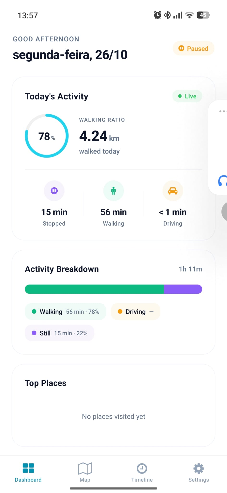
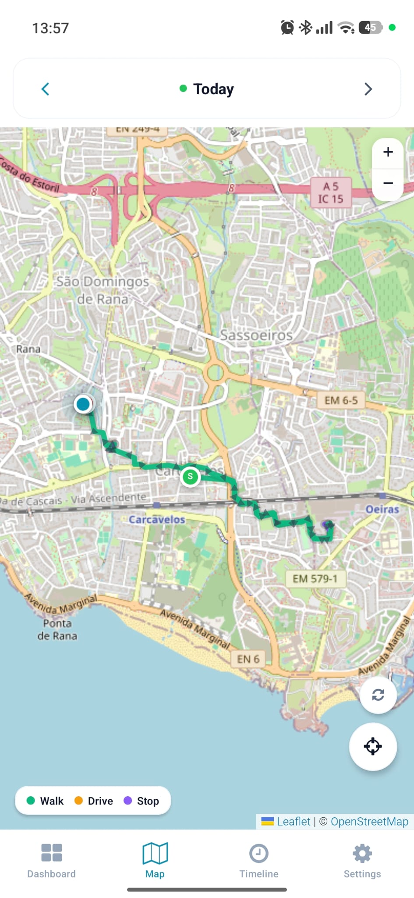
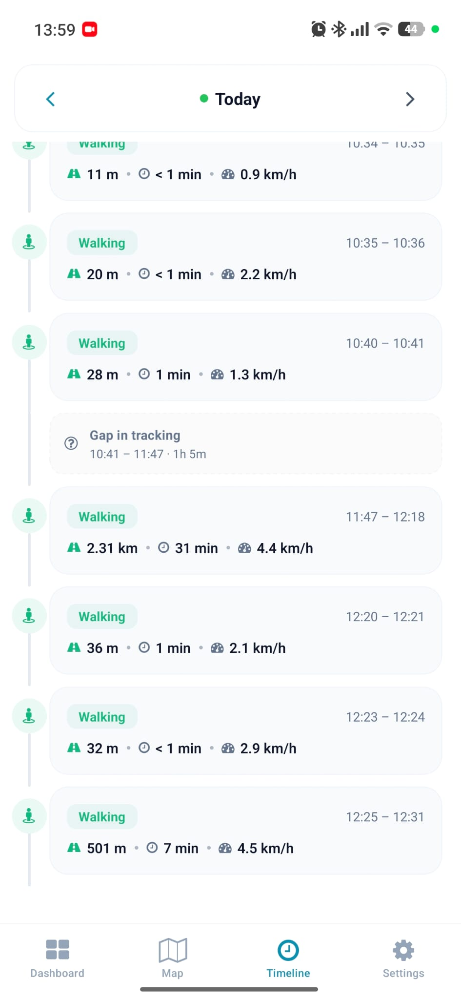
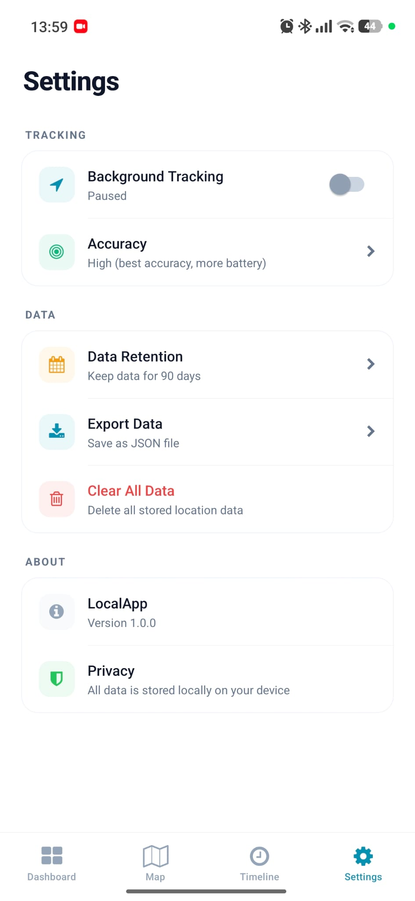

Mobile application that tracks your day in the background: GPS routes, visit duration, and detection of travel on foot or by transport.
Data is stored locally on the device using SQLite. Includes a timeline detailing your routes, a map displaying routes, daily summaries, and dashboard charts. 
Resumes tracking after the device restarts through background location tasks.

<table>
  <tr>
    <td></td>
    <td></td>
    <td></td>
    <td></td>
  </tr>
</table>
