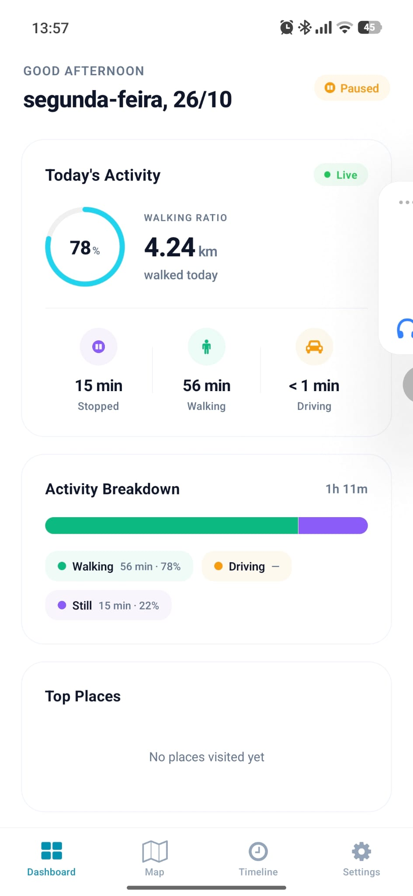
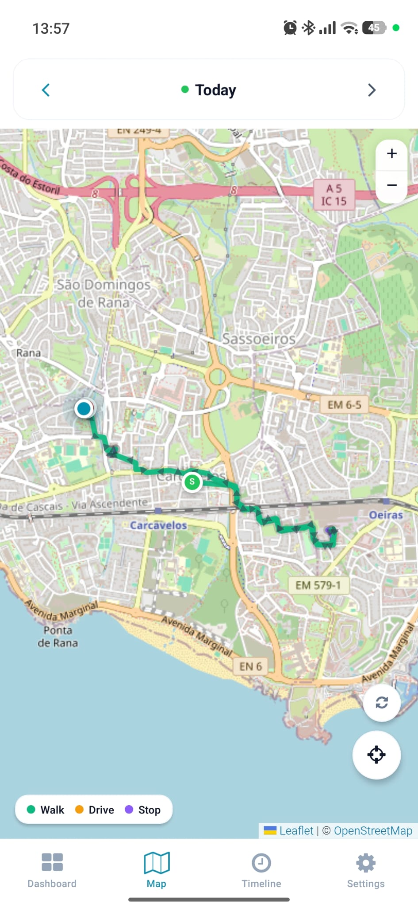
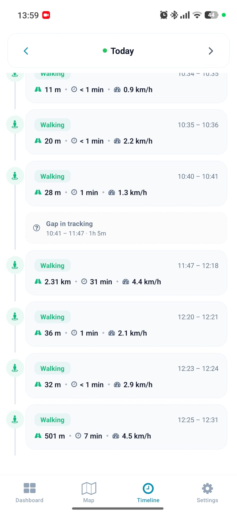
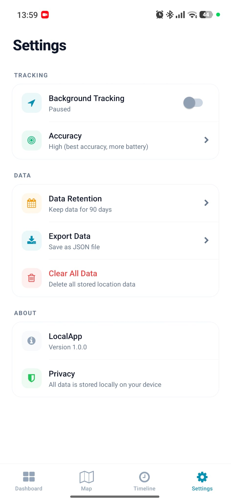

LocalApp is a mobile app that automatically records where you go during the day, with no manual input.

**Background tracking:** Records GPS routes even when the app is closed, resumes tracking after a device restart, and provides a detailed summary of each route.  
**Visit and movement detection:** Identifies places where the user stayed, how long they stayed, and whether they moved on foot or by transport.  
**Local-first storage:** All data stays on the phone in SQLite, which protects privacy and lets the app work offline.  
**Visualization:** A timeline of the day, a map with the routes, daily summaries and dashboard charts.

more detail: https://dot-groovy.github.io/portfolio/project/002/

<table>
  <tr>
    <td></td>
    <td></td>
  </tr>
  <tr>
    <td></td>
    <td></td>
  </tr>
</table>
