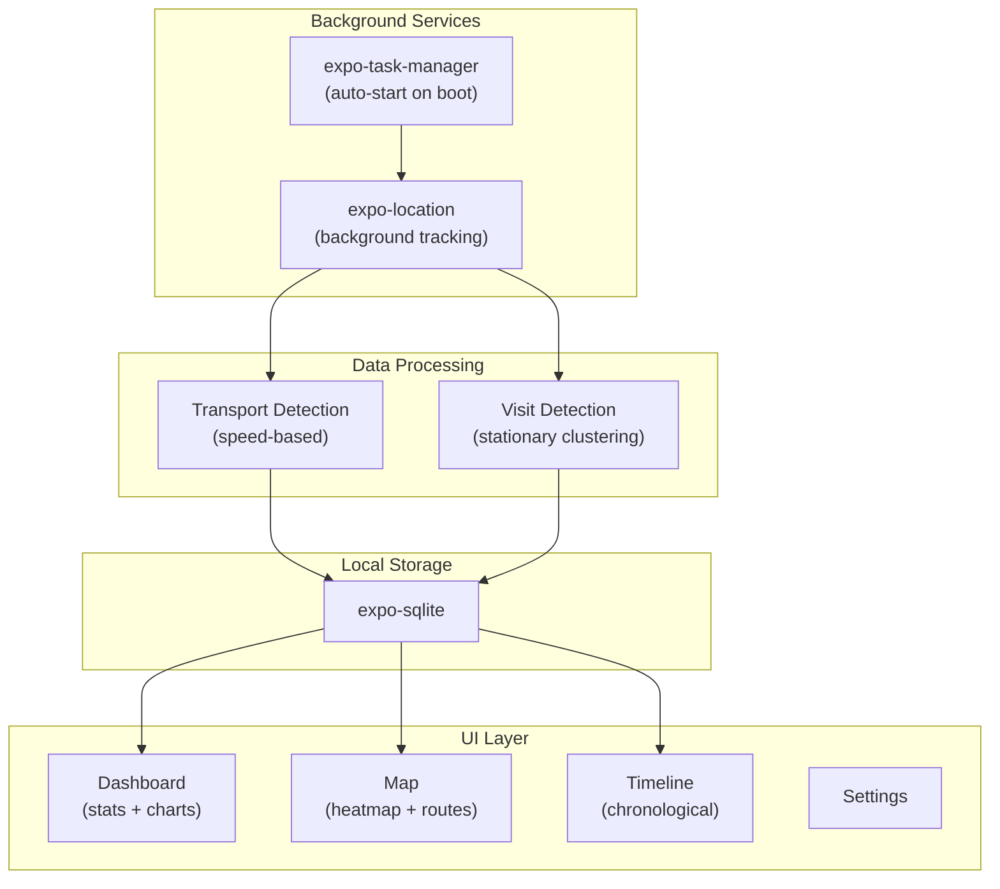

# LOCAL-APP -- Full Implementation Plan

## Tech Stack

- **Expo SDK 52** (latest stable with Expo Router v4)
- **expo-location** -- foreground + background location tracking
- **expo-task-manager** -- background task registration, auto-restart on boot
- **expo-sqlite** -- local-only SQLite database (no server)
- **react-native-maps** + heatmap layer -- map visualization
- **react-native-chart-kit** or **victory-native** -- dashboard charts
- **expo-router** -- file-based navigation (tabs)
- **nativewind** (Tailwind for RN) -- styling

---

## Architecture Overview




---

## Database Schema (expo-sqlite)

Four tables:

- **location_points** -- raw GPS points: `id, lat, lng, speed, heading, accuracy, altitude, timestamp`
- **visits** -- detected stays: `id, lat, lng, address, arrival_at, departure_at, duration_minutes`
- **trips** -- movement between visits: `id, start_lat, start_lng, end_lat, end_lng, start_at, end_at, transport_mode, distance_km`
- **daily_summary** -- aggregated daily stats: `id, date, total_distance_km, walking_min, driving_min, stationary_min, places_count`

---

## Transport Mode Detection

Based on speed from GPS data:

- **Stationary**: speed < 1 km/h for 5+ minutes --> creates a **visit**
- **Walking**: 1-8 km/h
- **Driving**: > 15 km/h
- **Transition zone** (8-15 km/h): use smoothing/majority over recent points

---

## Screens and Navigation (Tab-based)

### Tab 1: Dashboard (Home)

- Today's summary card: places visited, total distance, time breakdown
- Donut chart: time distribution (walking / driving / stationary)
- Bar chart: top 5 places by time spent
- Quick "last 7 days" comparison row

### Tab 2: Map

- Full-screen map with:
  - Heatmap overlay (time-weighted density of location points)
  - Route polylines color-coded by transport mode (blue=walking, red=driving)
  - Markers at visit locations with duration labels
- Date picker to switch between days

### Tab 3: Timeline

- Chronological list of the day's events:
  - Visit cards (place name, duration, arrival/departure)
  - Trip cards between visits (transport icon, distance, duration)
- Swipeable between days

### Tab 4: Settings

- Tracking on/off toggle
- Tracking accuracy (high/balanced/low battery)
- Data retention period
- Export data (JSON/CSV)
- Clear all data
- About / version

---

## File Structure

```
localApp/
  app.json
  package.json
  tsconfig.json
  app/
    _layout.tsx                 # Root layout (providers, DB init)
    (tabs)/
      _layout.tsx               # Tab navigator config
      index.tsx                 # Dashboard screen
      map.tsx                   # Map + heatmap screen
      timeline.tsx              # Timeline screen
      settings.tsx              # Settings screen
  src/
    database/
      schema.ts                 # Table definitions + migrations
      queries.ts                # CRUD operations for each table
      provider.tsx              # React context for DB instance
    services/
      locationTracking.ts       # Background location task + permissions
      transportDetection.ts     # Speed-based mode classification
      visitDetection.ts         # Stationary clustering logic
      dailySummary.ts           # Aggregation logic
    components/
      dashboard/
        SummaryCard.tsx
        TimeDistributionChart.tsx
        TopPlacesChart.tsx
      map/
        HeatmapLayer.tsx
        RoutePolyline.tsx
        VisitMarker.tsx
      timeline/
        VisitCard.tsx
        TripCard.tsx
        DaySelector.tsx
      common/
        Header.tsx
        EmptyState.tsx
        LoadingSpinner.tsx
    hooks/
      useLocations.ts
      useVisits.ts
      useTrips.ts
      useDailySummary.ts
      useTrackingStatus.ts
    utils/
      geo.ts                    # Distance calc, speed smoothing
      time.ts                   # Duration formatting
      constants.ts              # Thresholds, config
    types/
      index.ts                  # TypeScript interfaces
```

---

## Implementation Order

The build is divided into 6 phases, each producing a testable increment:

### Phase 1: Project scaffolding

- `npx create-expo-app` with Expo Router template
- Install all dependencies
- Set up tab navigation skeleton with placeholder screens
- Configure app.json (permissions, background modes)

### Phase 2: Database layer

- Define SQLite schema and migration in `src/database/schema.ts`
- Build CRUD query functions in `src/database/queries.ts`
- Create DB provider context that initializes on app start

### Phase 3: Background location tracking

- Request permissions (foreground + background)
- Register background task with expo-task-manager
- On each location batch, run transport detection + visit detection
- Store processed data in SQLite
- Handle auto-start on device boot

### Phase 4: Map screen

- Render map with react-native-maps
- Heatmap layer from location_points (weighted by dwell time)
- Route polylines color-coded by transport mode
- Visit markers with info callouts

### Phase 5: Dashboard and Timeline

- Dashboard: summary cards, donut chart (time), bar chart (places)
- Timeline: chronological visit/trip cards, day navigation

### Phase 6: Settings and polish

- Settings screen (tracking toggle, accuracy, export, clear data)
- Empty states, loading spinners, error handling
- Dark mode support
- App icon and splash screen


INICIAR O APP.

```worktree-shellscript
cd localApp
npx expo start          # starts dev server
npx expo start --web    # opens in browser (Windows PC)
npx expo start --android # connects to Android device/emulator
npx expo start --ios     # connects to iOS simulator
```

